# AthletiStat: Go Port Specification & Feasibility Plan

## Goal Description

Assess the feasibility of completely rewriting **AthletiStat** (a Python ETL pipeline for scraping, preprocessing, aggregating, and splitting World Athletics track and field performance records) in **Go (Golang)**, and provide an exhaustive, function-by-function technical specification mapping existing Python implementations to idiomatic Go equivalents.

---

## Executive Feasibility Verdict

> [!IMPORTANT]
> **Verdict: Highly Feasible and Strongly Recommended.**
> Recreating AthletiStat in Go is **100% technically feasible** and represents an optimal architectural upgrade for this specific workload.

### Key Feasibility Drivers

1. **Massive Throughput & Low Overhead in Scraping:**
   - *Python:* Uses `concurrent.futures.ThreadPoolExecutor` bound by GIL contention, OS thread limits, and heavyweight interpreter processes.
   - *Go:* Uses lightweight Goroutines (2 KB stack per worker vs ~8 MB per OS thread). A pool of 10–50 concurrent workers running over `net/http` with HTTP/2 multiplexing, connection pooling, and automatic keep-alive will scrape World Athletics with minimal CPU and memory consumption.
2. **Solving the 2.2+ GB / 14.3-Million-Row Dataset Bottleneck:**
   - *Python/Pandas:* The current historical seasons file (`combined_track_field_performances_2001_2026.csv`) is **2.21 GB and ~14,327,987 rows**. Reading, sorting, and combining these files in Pandas requires **8–14 GB of system RAM** and can trigger Out-Of-Memory (OOM) crashes on consumer machines.
   - *Go:* Using streaming CSV pipelines (`encoding/csv` coupled with `bufio.Reader` and `bufio.Writer`), Go can process, filter, and transform 14+ million rows with a **constant memory footprint of <50 MB** and 5–10x higher I/O throughput.
3. **Zero-Dependency Static Binary Deployment:**
   - *Python:* Requires Python runtime (3.11+ / 3.13t), virtual environment management, 9 third-party pip dependencies, and system C-libraries for parsing.
   - *Go:* Compiles into a single, self-contained, statically linked binary (`./athletistat`) with zero external runtime dependencies.
4. **Strong Typing & Data Contract Safety:**
   - Eliminates Pandas type-coercion pitfalls (`NaN` vs `None`, automatic float conversions of nullable integers, datetime parsing ambiguities) through strongly typed Go structs.

---

## User Review Required

> [!WARNING]
> **Data Processing Paradigm Shift: Pandas Vectorization vs. Go Streaming Structs**
> In Python, data manipulation is centered around Pandas DataFrames. In Go, the idiomatic approach is **typed struct streams** (`AthleticRecord`) processed using `bufio` and `encoding/csv`. While third-party Go dataframe libraries exist (such as `gota`), they are slower and less mature than native Go struct pipelines. We propose using **native typed Go structs** for maximum speed, type safety, and minimal memory usage.

> [!NOTE]
> **HTML Parsing Library Selection:**
> In Python, `BeautifulSoup(..., 'html.parser')` is used. In Go, the gold standard is `github.com/PuerkitoBio/goquery` (which provides a jQuery-style selector interface on top of Go's official `golang.org/x/net/html` parser).

---

## High-Level Architecture Comparison

```mermaid
flowchart TD
    subgraph Python ["Python Architecture (Current)"]
        py_cli["CLI (click)"] --> py_scraper["Scraper (ThreadPoolExecutor + requests + bs4)"]
        py_scraper --> py_csv_raw["Raw CSVs (data/processing/output)"]
        py_csv_raw --> py_prep["Preprocessor (pandas + regex)"]
        py_prep --> py_csv_clean["Clean CSVs (data/processing/combined)"]
        py_csv_clean --> py_gen["Generator (pandas concat + groupby)"]
        py_gen --> py_datasets["Final Datasets (data/datasets)"]
        py_datasets --> py_update["SeasonsUpdate (in-memory pandas filter)"]
    end

    subgraph Go ["Go Architecture (Proposed)"]
        go_cli["CLI (spf13/cobra)"] --> go_scraper["Scraper (Goroutine Pool + net/http + goquery)"]
        go_scraper --> go_csv_raw["Raw CSVs (bufio + encoding/csv)"]
        go_csv_raw --> go_prep["Preprocessor (Stream pipeline + typed structs)"]
        go_prep --> go_csv_clean["Clean CSVs (Buffered stream writes)"]
        go_csv_clean --> go_gen["Generator (Streaming partitioner & aggregator)"]
        go_gen --> go_datasets["Final Datasets (data/datasets)"]
        go_datasets --> go_update["SeasonsUpdate (Temp-file stream swap - zero OOM)"]
    end
```



---

## Dependency Mapping & Replacements

| Python Package / Module | Go Replacement Library | Rationale |
| :--- | :--- | :--- |
| `requests` + `urllib3` | `net/http` + `hashicorp/go-retryablehttp` | Standard library HTTP client with connection pooling; `go-retryablehttp` handles exponential backoff and retry codes (429, 500, 502, 503, 504). |
| `beautifulsoup4` | `github.com/PuerkitoBio/goquery` | Standard jQuery-like DOM parsing in Go, fast and robust HTML5 parsing backed by `x/net/html`. |
| `pandas` | `encoding/csv` + typed Go structs + `slices.SortFunc` | Vastly lower memory footprint (MBs instead of GBs), faster execution, native streaming, zero reflection overhead. |
| `click` | `github.com/spf13/cobra` | The industry-standard Go CLI framework (used by Kubernetes, Docker, GitHub CLI). Supports subcommands, flags, and help menus. |
| `tomllib` | `github.com/pelletier/go-toml/v2` | High-performance, spec-compliant TOML decoder for Go structs. |
| `tqdm` | `github.com/schollz/progressbar/v3` | Concurrent-safe, customizable terminal progress bar supporting in-place line rewriting and elapsed/ETA formatting. |
| `prettytable` | `github.com/olekukonko/tablewriter` | Standard ASCII/Unicode table generator for CLI outputs. |
| `pytest` | Standard `testing` package + `github.com/stretchr/testify` | Idiomatic Go unit and table-driven testing with assertion suites. |

---

## Detailed Function-by-Function Specification

Below is the complete inventory of all classes, methods, and functions across the AthletiStat codebase with their Go counterparts, signature specifications, and implementation designs.

### 1. Centralized Configuration (`athletistat/config.py`)

#### Python Implementation
- `ScraperConfig`, `PathsConfig`, `DisplayConfig`, `Config` (frozen dataclasses)
- `_load_config() -> Config`: Parses `athletistat/config.toml` with defaults fallback.
- `cfg`: Global configuration instance.

#### Go Replacement Specification (`pkg/config/config.go`)
```go
package config

type ScraperConfig struct {
    MaxWorkers         int      `toml:"max_workers"`
    ConnectTimeout     int      `toml:"connect_timeout"`
    ReadTimeout        int      `toml:"read_timeout"`
    RetryTotal         int      `toml:"retry_total"`
    RetryBackoffFactor float64  `toml:"retry_backoff_factor"`
    RetryStatusCodes   []int    `toml:"retry_status_codes"`
    PageDelay          float64  `toml:"page_delay"`
    UserAgent          string   `toml:"user_agent"`
    VerifySSL          bool     `toml:"verify_ssl"`
}

type PathsConfig struct {
    OptionsFile        string `toml:"options_file"`
    ScraperOutput      string `toml:"scraper_output"`
    QueueDir           string `toml:"queue_dir"`
    LogDir             string `toml:"log_dir"`
    CombinedDir        string `toml:"combined_dir"`
    DatasetDir         string `toml:"dataset_dir"`
    DatasetInfoFile    string `toml:"dataset_info_file"`
    DatasetSummaryFile string `toml:"dataset_summary_file"`
}

type DisplayConfig struct {
    ProgressBarWidth   int  `toml:"progress_bar_width"`
    RowCountChunkSize  int  `toml:"row_count_chunk_size"`
    ShowSaveLog        bool `toml:"show_save_log"`
}

type Config struct {
    Scraper ScraperConfig `toml:"scraper"`
    Paths   PathsConfig   `toml:"paths"`
    Display DisplayConfig `toml:"display"`
}

// DefaultConfig returns built-in defaults identical to Python dataclasses
func DefaultConfig() *Config

// LoadConfig reads config.toml and unmarshals over defaults
func LoadConfig(path string) (*Config, error)
```

---

### 2. Console Styling & Progress Bar (`athletistat/console.py`)

#### Python Functions
- `cprint(message, color, bold, prefix, dim)`: Styled ANSI terminal printing.
- `header(title, char, width)`: Section banner printing.
- `divider(char, width, color)`: Separator line.
- `success`, `warn`, `error`, `info`, `step`: Semantic alert printers.
- `ProgressBar`: `__init__`, `write(msg)`, `update(n)`, `finish()`.

#### Go Replacement Specification (`pkg/console/console.go`)
```go
package console

import (
    "sync"
    "github.com/schollz/progressbar/v3"
)

// ANSI Color constants matching Python Colors class
const (
    Reset   = "\033[0m"
    Bold    = "\033[1m"
    Dim     = "\033[2m"
    Red     = "\033[31m"
    Green   = "\033[32m"
    Yellow  = "\033[33m"
    Blue    = "\033[34m"
    Magenta = "\033[35m"
    Cyan    = "\033[36m"
    BrightGreen = "\033[92m"
    BrightYellow = "\033[93m"
    BrightRed    = "\033[91m"
    BrightCyan   = "\033[96m"
    BrightMagenta = "\033[95m"
)

// Symbols matching Python Symbols class
const (
    SymOK     = "✔"
    SymFail   = "✖"
    SymWarn   = "⚠"
    SymInfo   = "i"
    SymArrow  = "→"
    SymRocket = ">>"
    SymClock  = "⏱"
    SymSave   = "▼"
)

func Cprint(msg string, color string, bold bool, prefix string, dim bool)
func Header(title string, char string, width int)
func Divider(char string, width int, color string)
func Success(msg, detail string)
func Warn(msg string)
func Error(msg string)
func Info(msg string)
func Step(msg string)

type ProgressBar struct {
    bar  *progressbar.ProgressBar
    lock sync.Mutex
}

func NewProgressBar(total int, label string, width int) *ProgressBar
func (p *ProgressBar) Write(msg string)
func (p *ProgressBar) Update(n int)
func (p *ProgressBar) Finish()
```

---

### 3. Data Scraper (`athletistat/core/scraper.py`)

#### Python Implementation
- `Scraper.__init__(mode, options_file)`
- `Scraper._load_mappings(config_file)`: Reads options.json to build `(gender, ageCategory) -> [(disciplineSlug, typeSlug)]`.
- `Scraper.build_jobs(mode, year)`: Compiles list of job tuples.
- `Scraper.scrape_event(gender, age_category, discipline_slug, type_slug, output_dir, mode, year, progress_bar)`:
  - Paginates URL until table absent or empty.
  - Extracts 11 td columns from HTML table.
  - Saves CSV with pandas.
- `Scraper._get_queue_info(mode, year)`
- `Scraper._manage_queues_and_jobs(mode, year)`: Resumes partial scrape, caches completed seasons.
- `Scraper.run_scraper(mode, max_workers, year)`: Concurrency with `ThreadPoolExecutor`.
- `Scraper.run(max_workers, year)`: Dispatcher.

#### Go Replacement Specification (`pkg/scraper/scraper.go`)
```go
package scraper

import (
    "context"
    "net/http"
    "sync"
    "athletistat/pkg/config"
    "athletistat/pkg/console"
)

type ScrapeJob struct {
    Gender         string `json:"gender"`
    AgeCategory    string `json:"age_category"`
    DisciplineSlug string `json:"discipline_slug"`
    TypeSlug       string `json:"type_slug"`
    OutputDir      string `json:"output_dir"`
    Mode           string `json:"mode"`
    Year           int    `json:"year,omitempty"`
}

type RawRecord struct {
    Rank        string `csv:"rank"`
    Mark        string `csv:"mark"`
    Wind        string `csv:"wind"`
    Competitor  string `csv:"competitor"`
    DOB         string `csv:"dob"`
    Nationality string `csv:"nationality"`
    Position    string `csv:"position"`
    Venue       string `csv:"venue"`
    Date        string `csv:"date"`
    ResultScore string `csv:"result_score"`
    Discipline  string `csv:"discipline"`
    Type        string `csv:"type"`
    Sex         string `csv:"sex"`
    AgeCat      string `csv:"age_cat"`
}

type Scraper struct {
    cfg         *config.Config
    mode        string
    optionsFile string
    mappings    map[string][]DisciplinePair
    client      *http.Client
    fileLock    sync.Mutex
    today       string
    currentYear int
}

func NewScraper(cfg *config.Config, mode, optionsFile string) (*Scraper, error)
func (s *Scraper) LoadMappings(configFile string) (map[string][]DisciplinePair, error)
func (s *Scraper) BuildJobs(mode string, year int) []ScrapeJob
func (s *Scraper) ScrapeEvent(ctx context.Context, job ScrapeJob, bar *console.ProgressBar) (bool, error)
func (s *Scraper) GetQueueInfo(mode string, year int) string
func (s *Scraper) ManageQueuesAndJobs(mode string, year int) ([]ScrapeJob, string, []int, error)
func (s *Scraper) RunScraper(ctx context.Context, mode string, maxWorkers, year int) error
func (s *Scraper) Run(ctx context.Context, maxWorkers, year int) error
```

#### Go Concurrency Architecture
```go
// Worker Pool Pattern
jobsChan := make(chan ScrapeJob, len(jobs))
for _, job := range jobs {
    jobsChan <- job
}
close(jobsChan)

var wg sync.WaitGroup
for i := 0; i < maxWorkers; i++ {
    wg.Add(1)
    go func() {
        defer wg.Done()
        for job := range jobsChan {
            ok, err := s.ScrapeEvent(ctx, job, progressBar)
            // Synchronized queue state update and progress update
        }
    }()
}
wg.Wait()
```

---

### 4. Data Preprocessor (`athletistat/core/preprocessing.py`)

#### Python Implementation
- `Preprocessor.__init__(mode, options_file)`: Reads options.json country lookups, initializes event classification sets.
- `Preprocessor.normalize_discipline(slug)`: Alias replacements and regex suffix stripping (`re.sub`).
- `Preprocessor.parse_mark_to_number(mark)`: Time string parsing (`MM:SS.ss` / `H:MM:SS.ss` -> total seconds as float).
- `Preprocessor.extract_country_code_from_venue(venue)`: Regex extraction of `\((\w{3})\)`.
- `Preprocessor._get_files_by_key(mode, year)`: Groups raw CSVs by `(year, gender, type, discipline)`.
- `Preprocessor.process_data(mode, year)`: Normalizes columns, parses dates, calculates `age_at_event = (date - dob).days // 365`, extracts `season`, sorts ascending/descending by `mark_numeric`, writes to `combined/`.
- `Preprocessor.run(year)`: Mode execution dispatcher.

#### Go Replacement Specification (`pkg/preprocessor/preprocessor.go`)
```go
package preprocessor

import (
    "time"
    "athletistat/pkg/config"
)

type ProcessedRecord struct {
    RawRecord
    NormalizedDiscipline string    `csv:"normalized_discipline"`
    TrackField           string    `csv:"track_field"`
    MarkNumeric          float64   `csv:"mark_numeric"`
    NatFull              string    `csv:"nat_full"`
    VenueCountry         string    `csv:"venue_country"`
    ParsedDOB            time.Time `csv:"-"`
    ParsedDate           time.Time `csv:"-"`
    AgeAtEvent           int       `csv:"age_at_event"`
    Season               int       `csv:"season"`
}

type Preprocessor struct {
    cfg             *config.Config
    mode            string
    countryLookup   map[string]string
    manualAliases   map[string]string
    ascendingTypes  map[string]bool
    descendingTypes map[string]bool
    trackTypes      map[string]bool
    fieldTypes      map[string]bool
    mixedTypes      map[string]bool
}

func NewPreprocessor(cfg *config.Config, mode, optionsFile string) (*Preprocessor, error)
func (p *Preprocessor) NormalizeDiscipline(disciplineSlug string) string
func (p *Preprocessor) ParseMarkToNumber(mark string) float64
func (p *Preprocessor) ExtractCountryCodeFromVenue(venue string) string
func (p *Preprocessor) GetFilesByKey(mode string, year int) (map[GroupKey][]string, error)
func (p *Preprocessor) ProcessData(mode string, year int) error
func (p *Preprocessor) Run(year int) error
```

#### Key Logic Re-implementations in Go
- **Mark Parsing:**
  ```go
  func (p *Preprocessor) ParseMarkToNumber(mark string) float64 {
      mark = strings.TrimSpace(strings.ToLower(strings.ReplaceAll(mark, "h", "")))
      if strings.Contains(mark, ":") {
          parts := strings.Split(mark, ":")
          if len(parts) == 3 {
              h, _ := strconv.ParseFloat(parts[0], 64)
              m, _ := strconv.ParseFloat(parts[1], 64)
              s, _ := strconv.ParseFloat(parts[2], 64)
              return h*3600 + m*60 + s
          } else if len(parts) == 2 {
              m, _ := strconv.ParseFloat(parts[0], 64)
              s, _ := strconv.ParseFloat(parts[1], 64)
              return m*60 + s
          }
          return math.Inf(1)
      }
      val, err := strconv.ParseFloat(mark, 64)
      if err != nil {
          return math.Inf(1)
      }
      return val
  }
  ```
- **Date & Age Calculation:**
  ```go
  // Parsing format "02 Jan 2006" corresponds to Python "%d %b %Y"
  date, err1 := time.Parse("02 Jan 2006", row.Date)
  dob, err2 := time.Parse("02 Jan 2006", row.DOB)
  if err1 == nil && err2 == nil {
      days := int(date.Sub(dob).Hours() / 24)
      row.AgeAtEvent = days / 365
  }
  ```

---

### 5. Dataset Generator & Splitter (`athletistat/core/generator.py`)

#### Python Implementation
- `DatasetGenerator.generate_datasets(mode, year)`: Concatenates cleaned files into `{year}_track_field_performances.csv` or `top_track_field_performances_all_time.csv` (with deduplication).
- `DatasetGenerator.combine_seasons()`: Merges all single-season CSVs into `combined_track_field_performances_{min}_{max}.csv`.
- `DatasetGenerator.run(combine, year)`
- `DatasetSplitter.get_filename_with_years(base_name, df, is_seasons)`: Formats output filename with year range.
- `DatasetSplitter.split_dataset(df, mode_dir, is_seasons)`: Partitions rows into `split_global`, `split_by_type`, `split_by_discipline`, and `relays`. Drops `dob` and `age_at_event` for relays.
- `DatasetSplitter.execute_splits()`
- `DatasetSplitter.run()`

#### Go Replacement Specification (`pkg/generator/generator.go` & `pkg/generator/splitter.go`)
```go
package generator

import (
    "athletistat/pkg/config"
)

type DatasetGenerator struct {
    cfg  *config.Config
    mode string
}

func NewDatasetGenerator(cfg *config.Config, mode string) *DatasetGenerator
func (g *DatasetGenerator) GenerateDatasets(mode string, year int) error
func (g *DatasetGenerator) CombineSeasons() error
func (g *DatasetGenerator) Run(combine bool, year int) error

type DatasetSplitter struct {
    cfg  *config.Config
    mode string
}

func NewDatasetSplitter(cfg *config.Config, mode string) *DatasetSplitter
func (s *DatasetSplitter) GetFilenameWithYears(baseName string, minYear, maxYear int, isSeasons bool) string
func (s *DatasetSplitter) SplitDatasetStream(sourceCSVPath, modeDir string, isSeasons bool) error
func (s *DatasetSplitter) ExecuteSplits() error
func (s *DatasetSplitter) Run() error
```

#### Go Memory Optimization for 14M+ Rows Splitting
Instead of loading 14 million rows into a giant slice in memory, the Go splitter can open writer handles in a multiplexer map:
```go
// Writers are opened on demand and cached:
type StreamRouter struct {
    writers map[string]*csv.Writer
    files   map[string]*os.File
}
// For each row in source CSV:
// - Determine target file paths (global, type, discipline, relay)
// - Route row to corresponding buffered writers
// - Flush and close at EOF
```
This guarantees **O(1) memory usage** regardless of whether the dataset is 100 MB or 100 GB.

---

### 6. Seasons Update (`athletistat/core/seasons_update.py`)

#### Python Implementation
- `SeasonsUpdate.__init__(year, generate)`
- `SeasonsUpdate._find_combined_file()`: Globs for existing combined dataset.
- `SeasonsUpdate._run_pipeline()`: Runs Scraper -> Preprocessor -> Generator for year.
- `SeasonsUpdate._load_csv()`
- `SeasonsUpdate._delete_year_records(df)`: In-memory Pandas row filter.
- `SeasonsUpdate._append_year_data(combined_df, year_df)`
- `SeasonsUpdate._save_combined(df)`: Writes new combined CSV, renames file based on min/max year, deletes old file.
- `SeasonsUpdate.run()`

#### Go Replacement Specification (`pkg/updater/updater.go`)
```go
package updater

import (
    "context"
    "athletistat/pkg/config"
)

type SeasonsUpdate struct {
    cfg          *config.Config
    year         int
    generate     bool
    datasetDir   string
    combinedFile string
    yearFile     string
}

func NewSeasonsUpdate(cfg *config.Config, year int, generate bool) *SeasonsUpdate
func (u *SeasonsUpdate) FindCombinedFile() (string, error)
func (u *SeasonsUpdate) RunPipeline(ctx context.Context) error
func (u *SeasonsUpdate) UpdateCombinedFileStream() (int, int, error) // Returns rowsBefore, rowsAfter
func (u *SeasonsUpdate) Run(ctx context.Context) error
```

#### Zero-OOM Stream Replacement Strategy
```go
// 1. Create a temp file
tempFile, _ := os.CreateTemp(u.datasetDir, "combined_update_*.csv")

// 2. Stream existing combined CSV:
//    Copy all rows where row[seasonCol] != targetYear to tempFile
//    Count rows kept

// 3. Stream target year CSV:
//    Copy all rows to tempFile (skipping header)
//    Count rows added

// 4. Atomic rename tempFile -> combined_track_field_performances_{min}_{max}.csv
// 5. Delete old combined file if filename changed
```
*Result:* Runs in **<15 seconds** using **<10 MB RAM** compared to Python's **2+ minutes** and **8+ GB RAM**.

---

### 7. Dataset Inspection & Documentation (`athletistat/scripts/fetch_info.py`)

#### Python Implementation
- `DatasetInfo.__init__()`: Sets up PrettyTable.
- `DatasetInfo.count_rows(filename)`: 1 MB chunk byte counting of `\n`.
- `DatasetInfo.get_file_size(filepath)`: Formats size into MB/GB.
- `DatasetInfo.generate_info()`: Scans CSVs, prints/saves `data/datasets/dataset_info.txt`.
- `DatasetInfo.generate_summary()`: Replaces README anchor block `<!-- START_DATASET_INFO -->...<!-- END_DATASET_INFO -->`.

#### Go Replacement Specification (`pkg/info/info.go`)
```go
package info

import (
    "athletistat/pkg/config"
    "github.com/olekukonko/tablewriter"
)

type DatasetInfo struct {
    cfg *config.Config
}

func NewDatasetInfo(cfg *config.Config) *DatasetInfo
func (d *DatasetInfo) CountRows(filename string) (int64, error)
func (d *DatasetInfo) GetFileSize(filepath string) string
func (d *DatasetInfo) GenerateInfo() error
func (d *DatasetInfo) GenerateSummary() error
```

#### SIMD-Accelerated Line Counting in Go
```go
func (d *DatasetInfo) CountRows(filename string) (int64, error) {
    file, err := os.Open(filename)
    if err != nil {
        return 0, err
    }
    defer file.Close()

    buf := make([]byte, d.cfg.Display.RowCountChunkSize)
    var count int64
    for {
        n, err := file.Read(buf)
        if n > 0 {
            count += int64(bytes.Count(buf[:n], []byte{'\n'}))
        }
        if err != nil {
            break
        }
    }
    if count > 0 {
        count-- // Subtract CSV header row
    }
    return count, nil
}
```

---

### 8. CLI Entry Point (`athletistat/cli/cli.py` & `AthletiStat`)

#### Python Implementation
- Uses `click` command and options: `--scraper`, `--preprocessing`, `--create-dataset`, `--combine`, `--split-dataset`, `--fetch-data`, `--year`, `--dataset-info`, `--update-season`, `--no-generate`.
- Executable wrapper: `./AthletiStat`.

#### Go Replacement Specification (`cmd/athletistat/main.go`)
Implemented with `github.com/spf13/cobra`:
```go
package main

import (
    "github.com/spf13/cobra"
)

func main() {
    var (
        scraper       string
        preprocessing string
        createDataset string
        combine       bool
        splitDataset  string
        fetchData     string
        year          int
        datasetInfo   bool
        updateSeason  bool
        noGenerate    bool
    )

    rootCmd := &cobra.Command{
        Use:   "athletistat",
        Short: "AthletiStat - Track & Field Data Pipeline",
        RunE: func(cmd *cobra.Command, args []string) error {
            // Orchestrate commands matching Python CLI flow
            return nil
        },
    }

    rootCmd.Flags().StringVar(&scraper, "scraper", "", "Scrape data for seasons or all-time.")
    rootCmd.Flags().StringVar(&preprocessing, "preprocessing", "", "Preprocess scraped data.")
    rootCmd.Flags().StringVar(&createDataset, "create-dataset", "", "Generate datasets from preprocessed data.")
    rootCmd.Flags().BoolVar(&combine, "combine", false, "Combine datasets in season for all years scraped.")
    rootCmd.Flags().StringVar(&splitDataset, "split-dataset", "", "Splits datasets according to gender, discipline, and event type.")
    rootCmd.Flags().StringVar(&fetchData, "fetch-data", "", "Performs --scraper, --preprocessing and --create-dataset for given mode.")
    rootCmd.Flags().IntVar(&year, "year", 0, "Year to use for seasons mode.")
    rootCmd.Flags().BoolVar(&datasetInfo, "dataset-info", false, "Generates a txt file of dataset information.")
    rootCmd.Flags().BoolVar(&updateSeason, "update-season", false, "Update the combined seasons dataset for a given year.")
    rootCmd.Flags().BoolVar(&noGenerate, "no-generate", false, "Skip scrape/preprocess/generate.")

    rootCmd.Execute()
}
```

---

## Proposed Project Layout (Idiomatic Go)

```text
AthletiStat-Go/
├── cmd/
│   └── athletistat/
│       └── main.go                  # Cobra CLI application entry point
├── pkg/
│   ├── config/
│   │   ├── config.go                # TOML config loading and typed structs
│   │   └── config_test.go
│   ├── console/
│   │   ├── colors.go                # ANSI terminal styling and symbols
│   │   ├── progress.go              # Thread-safe terminal progress bar
│   │   └── console_test.go
│   ├── scraper/
│   │   ├── scraper.go               # Worker pool, HTTP client, DOM parsing
│   │   ├── queue.go                 # Persistent JSON queue and resume engine
│   │   └── scraper_test.go
│   ├── preprocessor/
│   │   ├── preprocessor.go          # Normalization, mark parsing, age calculator
│   │   ├── normalizer.go            # Discipline alias mapping and regex rules
│   │   └── preprocessor_test.go
│   ├── generator/
│   │   ├── generator.go             # Dataset concatenation & deduplication
│   │   ├── splitter.go              # Gender, discipline, event-type partitioner
│   │   └── generator_test.go
│   ├── updater/
│   │   ├── updater.go               # In-place streaming season replacement
│   │   └── updater_test.go
│   └── info/
│       ├── info.go                  # Row counter, size calculator, README updater
│       └── info_test.go
├── config.toml                      # Centralized configuration
├── options.json                     # WA discipline & regional metadata
├── go.mod
├── go.sum
├── Makefile                         # Build, test, and benchmark targets
└── README.md
```

---

## Verification Plan

### Automated Test Suite Equivalents

Every existing pytest module will be mapped 1:1 to standard Go unit tests:
1. `tests/test_preprocessing.py` ➔ `pkg/preprocessor/preprocessor_test.go`
   - Test discipline normalization (exact aliases, partial substitutions, regex suffix stripping).
   - Test mark parsing (`MM:SS.ss`, `H:MM:SS.ss`, hand-timing `h`, unparseable marks to `+Inf`).
   - Test venue 3-letter country code regex.
   - Test country lookup dictionary.
2. `tests/test_scraper.py` ➔ `pkg/scraper/scraper_test.go`
   - Test `_load_mappings` from mock `options.json`.
   - Test `BuildJobs` for `seasons` and `all-time`.
   - Test `ScrapeEvent` with mock HTTP server (`httptest.Server`).
   - Test queue persistence and recovery on interrupted scrape.
3. `tests/test_generator.py` ➔ `pkg/generator/generator_test.go`
   - Test concatenation of per-discipline CSVs.
   - Test all-time deduplication.
   - Test multi-season merge with year-range naming (`combined_..._YYYY_YYYY.csv`).
   - Test dataset splitter (individual vs relay, gender separation, column dropping).
4. `tests/test_cli.py` ➔ `cmd/athletistat/main_test.go`
   - Test CLI flag parsing and execution paths.

### Cross-Language Parity Verification (Golden Dataset Test)
1. Run Python pipeline on a sample year (e.g. 2024, 1 event).
2. Run Go pipeline on the exact same HTML fixture.
3. Diff the generated CSV files (`diff -u python_output.csv go_output.csv`).
4. Ensure 100% identical headers, row order, column formatting, and floating point representations.

---

## Phased Implementation Roadmap

1. **Phase 1: Foundation (`pkg/config`, `pkg/console`)**
   - Implement TOML configuration loader and ANSI console helpers.
   - Set up progress bar wrapper.
2. **Phase 2: Core Data Preprocessing (`pkg/preprocessor`)**
   - Port all normalization regexes, mark parsers, and date arithmetic.
   - Validate with full unit test suite matching `test_preprocessing.py`.
3. **Phase 3: Scraper & Queue Engine (`pkg/scraper`)**
   - Implement `goquery` DOM extractor.
   - Build Goroutine worker pool with rate-limiting and exponential backoff retry.
   - Implement JSON queue persistence and completed seasons registry.
4. **Phase 4: Dataset Generator, Splitter & Seasons Update (`pkg/generator`, `pkg/updater`)**
   - Implement zero-OOM streaming CSV generator and splitter.
   - Implement atomic in-place season updater.
5. **Phase 5: CLI, Documentation & Parity Verification (`cmd/athletistat`, `pkg/info`)**
   - Wire all components into Cobra CLI.
   - Run end-to-end golden dataset verification against Python outputs.
   - Benchmark throughput and memory improvements.
